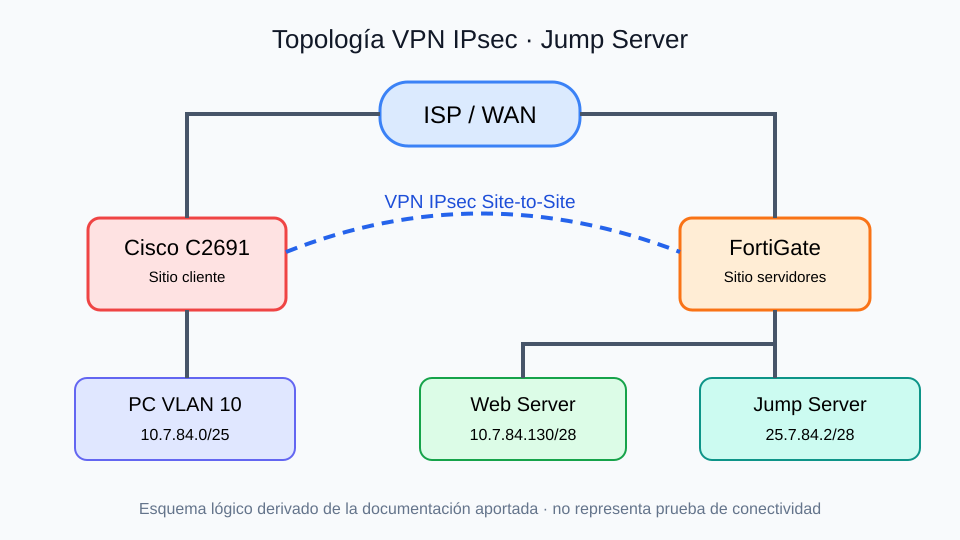

# Infraestructura segura con VPN Site-to-Site, Jump Server y RemoteApp

**Laboratorio académico — PNETLab** · **Matrícula:** 2025-0784 · **FortiGate 7.0.3 / Cisco C2691 / Windows Server 2019**

## 🎥 Video demostrativo
https://itlaedudo-my.sharepoint.com/:v:/g/personal/20250784_itla_edu_do/IQAZGMfQFaFhRYt0deEd5BbRAW13-sAJONJzi-pegdeUpzA?e=WB6Ybv&nav=eyJyZWZlcnJhbEluZm8iOnsicmVmZXJyYWxBcHAiOiJTdHJlYW1XZWJBcHAiLCJyZWZlcnJhbFZpZXciOiJTaGFyZURpYWxvZy1MaW5rIiwicmVmZXJyYWxBcHBQbGF0Zm9ybSI6IldlYiIsInJlZmVycmFsTW9kZSI6InZpZXcifX0%3D

## Descripción
El objetivo es que los clientes de la VLAN 10 se conecten mediante un túnel IPsec al **Jump Server**, sin acceso directo al Web Server (Sistema de Caja). El Jump Server publica aplicaciones RemoteApp y se conecta al Web Server con los servicios autorizados.

**Importante:** esta documentación combina un diseño propuesto con archivos de ejemplo aportados para el laboratorio; **no se han validado en ejecución** las conexiones, reglas ni servicios. No se deben tomar las pruebas esperadas como resultados ya conseguidos.

## 📚 Índice de documentación
| Documento | Contenido / dónde colocar evidencias |
|---|---|
| [Topología y direccionamiento](docs/01-topologia-y-direccionamiento.md) | Interfaces, VLAN, subredes y esquema |
| [Configuración Cisco](docs/02-cisco-y-switch.md) | Router C2691, switch, DHCP, NAT y comandos de comprobación |
| [FortiGate por GUI](docs/03-fortigate-gui.md) | Interfaces, objetos, rutas, políticas y capturas |
| [VPN IPsec](docs/04-vpn-ipsec.md) | Fase 1/2, selectores, rutas, túnel y pruebas |
| [Jump Server](docs/05-jump-server.md) | AD/DNS, usuarios, RDS, RemoteApp y AppLocker |
| [Web Server](docs/06-web-server.md) | IIS, HTTPS, RDP, SSH y firewall local |
| [Matriz de políticas](docs/07-politicas-de-seguridad.md) | Reglas y mínimo privilegio |
| [Pruebas / evidencias](docs/08-pruebas-y-evidencias.md) | Capturas pendientes y resultados verificables |

## Direccionamiento propuesto
| Segmento | Subred | Dirección |
|---|---|---|
| ISP WAN (simulada) | 192.168.20.0/24 | Cisco fa0/0 y FortiGate port1 por confirmar |
| Usuarios VLAN 10 | 10.7.84.0/25 | Cisco fa0/1.10 = 10.7.84.1 |
| Web Server | 10.7.84.128/28 | FortiGate port2 = 10.7.84.129; WEB01 = 10.7.84.130 |
| Jump Server | 25.7.84.0/28 | FortiGate port3 = 25.7.84.1; JUMP01 = 25.7.84.2 |

> 25.7.84.0/28 no es un bloque privado RFC1918. Utilizarlo únicamente en un entorno aislado de prácticas; en una infraestructura real debe sustituirse por una red privada.

## Accesos previstos
- **Cliente VLAN 10 → Jump Server (VPN):** HTTPS 443 y RDP 3389 cuando corresponda.
- **Cliente VLAN 10 → Web Server (directo):** denegar.
- **Jump Server → Web Server:** HTTPS 443, RDP 3389, SSH 22; denegar otros servicios.
- **Jump Server → Internet:** DNS 53, HTTP 80 y HTTPS 443, mediante política NAT si existe salida.

El control de acceso de `usr_priv` y `usr_nopriv` se aplica principalmente en Windows/RDS/AppLocker; las reglas de firewall basadas solo en IP no identifican de manera confiable a usuarios de dominio.

## Archivos del proyecto
- [Scripts PowerShell](scripts/) — **plantillas de laboratorio**, revisar antes de ejecutar.
- [Configuraciones de red](running-configs/) — muestras iniciales, sustituir por respaldos reales depurados.
- [Evidencias](evidencias/) — instrucciones y nomenclatura de capturas.
- [Imagen](images/topologia-laboratorio.svg) — diagrama proporcionado.
- [Observaciones de seguridad](docs/09-observaciones-y-pendientes.md) — aspectos a corregir y verificar.

## Próximos pasos
1. Completar y confirmar la configuración real del VPN Cisco ↔ FortiGate.
2. Exportar el **backup real** del FortiGate desde la GUI, quitar datos sensibles y reemplazar el marcador en `running-configs/`.
3. Adjuntar capturas con los nombres indicados en `evidencias/README.md`.
4. Confirmar despliegue RemoteApp y privilegios con sesiones de ambos usuarios.
5. Publicar enlace del video arriba.

**Seguridad:** no subir contraseñas, claves PSK, certificados privados ni configuraciones sin sanitizar a un repositorio público.
